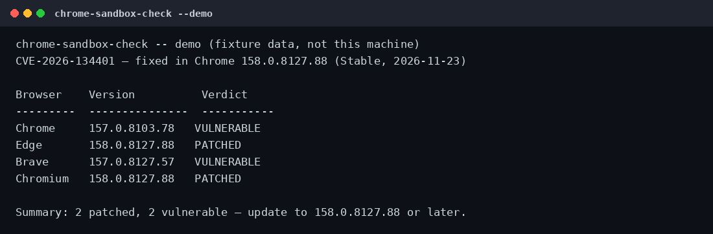

# chrome-sandbox-check



**One command tells you in ~50 ms whether every Chromium browser on your machine is patched against the CVSS 9.6 sandbox escape CVE-2026-134401 — before you open a single tab.**

CVE-2026-134401 is an improper input validation flaw in Chrome's Variations component: a crafted HTML page could let a remote attacker execute arbitrary code *outside* the browser sandbox. Google fixed it in the Stable channel update of 2026-11-23 — desktop Chrome **158.0.8127.88** (Windows and Mac also shipped 158.0.8127.89). If your Chrome, Edge, Brave, or Chromium is below that build, you are one bad link away from a sandbox escape.

## Who this is for

Anyone who runs a Chromium-family browser and doesn't want to dig through `chrome://version` on four apps to answer one question: *am I patched?* Security folks triaging a fleet, developers who live in the browser, and anyone who saw the CVE-2026-134401 headlines and wants a yes/no answer in under a second. Star it if you want a copy on hand the next time Chrome ships an emergency fix — the fixed version is a one-line change.

## Quick start — 30 seconds

Requires Python 3.8+ only. No dependencies, no install, no network calls.

```bash
git clone https://github.com/Mahgal/chrome-sandbox-check.git
cd chrome-sandbox-check
python3 chrome_sandbox_check.py
```

That's it. The scan reads each installed browser's self-reported version (`--version`) and verdicts it against the fixed build.

See it without a browser installed:

```bash
python3 chrome_sandbox_check.py --demo
```

Run the tests:

```bash
python3 tests/run_tests.py
```

## Example output

This is the real output of `python3 chrome_sandbox_check.py --demo` (fixture data, so it is identical on every machine):

```
chrome-sandbox-check -- demo (fixture data, not this machine)
CVE-2026-134401 — fixed in Chrome 158.0.8127.88 (Stable, 2026-11-23)

Browser    Version          Verdict
---------  ---------------  -----------
Chrome     157.0.8103.78   VULNERABLE
Edge       158.0.8127.88   PATCHED
Brave      157.0.8127.57   VULNERABLE
Chromium   158.0.8127.88   PATCHED

Summary: 2 patched, 2 vulnerable — update to 158.0.8127.88 or later.
```

On a live machine the same table lists the browsers actually installed. A real scan on a machine with no Chromium browser prints `No Chromium-family browser found on this machine.` and exits 0.

## Exit codes

| Code | Meaning |
| ---- | ------- |
| 0 | Every browser found is patched — or no Chromium browser was found |
| 1 | At least one browser is vulnerable, or a version could not be read |
| 2 | Usage error (bad arguments) |

## What this checks — and what it doesn't

**It checks:** the installed version of Chrome, Chromium, Edge, and Brave (Linux, macOS, and Windows install paths, plus `PATH` lookups) against the fixed build 158.0.8127.88, with correct numeric per-component comparison — `158.0.8127.89` counts as patched, `158.0.8127.87` does not, and `158` equals `158.0.0.0`.

**It does not:** exploit anything, probe any website, or make any network call. It cannot tell you whether a browser is *running* the patched version right now — a browser that downloaded the update but hasn't been restarted still reports its old version until you relaunch it. After updating, restart the browser and re-run the check.

## Sources

- Chrome Releases blog, Stable Channel Update for Desktop, 2026-11-23: <https://chromereleases.googleblog.com/2026/11/stable-channel-update-for-desktop_01734282054.html>
- NVD, CVE-2026-134401: <https://nvd.nist.gov/vuln/detail/CVE-2026-134401>
- CVE.org record: <https://www.cve.org/CVERecord?id=CVE-2026-134401>

CVSS 9.6 is the score for the published CVSS:3.1 vector `AV:N/AC:L/PR:N/UI:R/S:C/C:H/I:H/A:H` (CISA-ADP, shown on the NVD record); NVD's own base-score assessment was still pending when this was built.

## License

MIT — see [LICENSE](LICENSE).
